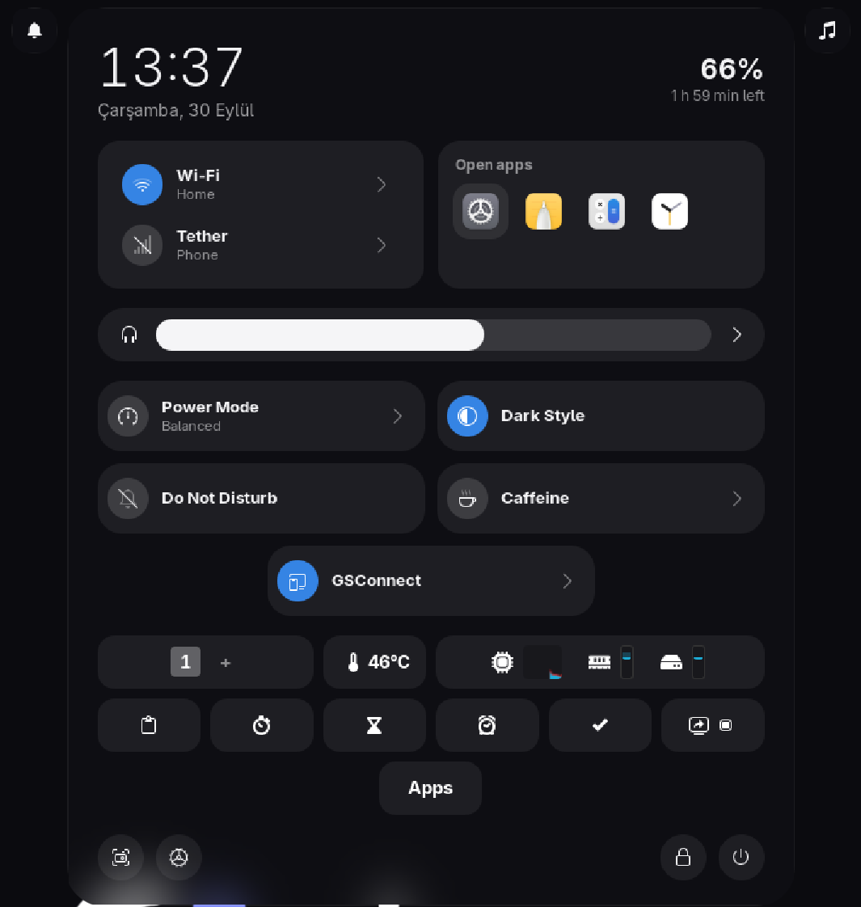
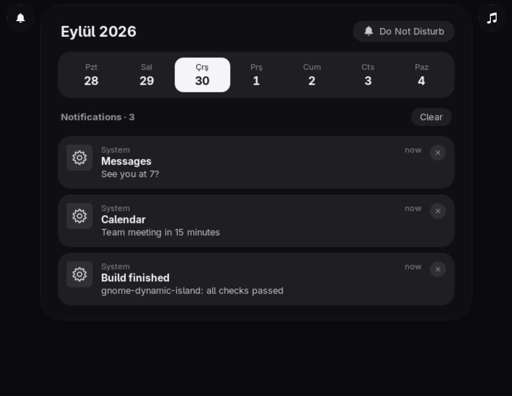
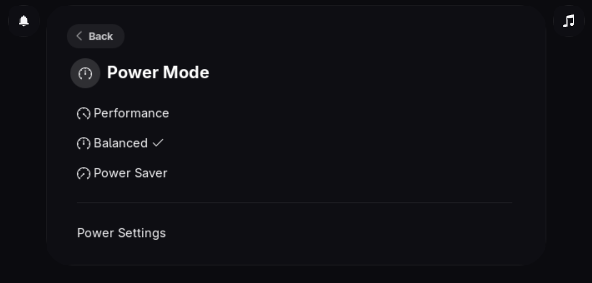
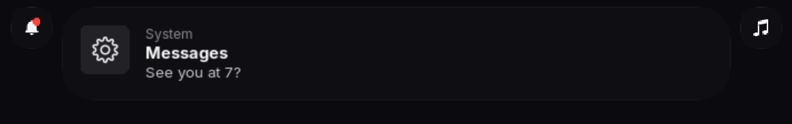
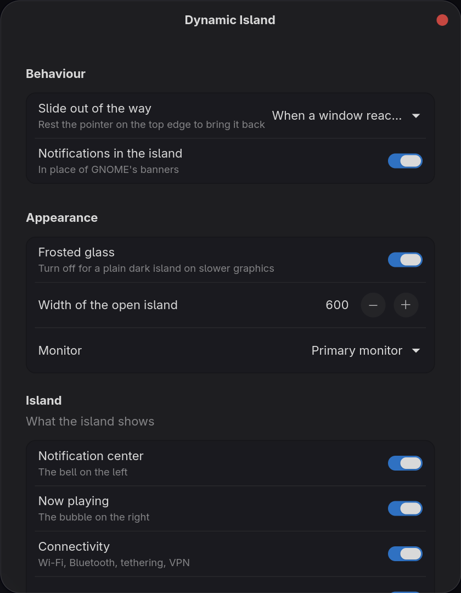

# Dynamic Island for GNOME

A GNOME Shell extension that turns the top bar into a small frosted-glass island in the middle of the screen, with a control center, notifications, now playing, live activities and a command palette.

<p align="center"></p>

<p align="center">
  
  
</p>

**Contents:** [Features](#features) · [Requirements](#requirements) · [Install](#install) · [Settings](#settings) · [Keyboard shortcuts](#keyboard-shortcuts) · [Colour themes](#colour-themes) · [Troubleshooting](#troubleshooting) · [Translating](#translating) · [Contributing](#contributing)

## Features

### The collapsed island

A small pill in the middle of the top edge with the time, date and battery. The normal top bar is hidden and reserves no space, so windows use the whole screen. The notification bell sits on its left and the now playing bubble on its right. A running timer or other live activity shows up in the pill too.

### Control center

Click the island and it springs open, its modules drifting in one after another:

- a large clock and the battery time left
- a connectivity card (Wi-Fi, Bluetooth, tethering, VPN, airplane mode) and the apps that are open right now
- sliders for volume, microphone and brightness
- every other Quick Settings toggle as a tile: power mode, dark style, night light, Do Not Disturb, and the ones other extensions add
- the panel icons of your other extensions
- screenshot, settings, lock and power buttons along the bottom

GNOME's own Quick Settings items are moved into the island, so they behave exactly as they do in GNOME. A toggle's arrow slides over to a page of its own (the Wi-Fi networks, the power options) with a Back button.

<p align="center"></p>

Your screen will show different tiles from the screenshot above: it depends on which extensions you have installed.

### Notifications and the notification center

Notifications appear in the island instead of GNOME's banners, with the same rules (Do Not Disturb, per-app settings, urgency). This can be turned off in the settings.

<p align="center"></p>

The bell on the left opens the notification center: a week strip, a Do Not Disturb switch and your notifications as cards, with a Clear button. A red dot on the bell means something arrived that you have not seen. `Super+V` (GNOME's usual shortcut for the calendar and notifications) opens it too.

### Now playing

The bubble on the right shows what is playing: Spotify, a video in the browser, any MPRIS player. It lights up while something plays. Click it for cover art, progress and controls.

### Live activities and the `dynada` command

Timers and anything else in progress stay in the island, a bit like iPhone Live Activities: a countdown in the collapsed pill, a card with progress at the top of the control center, a notification and a sound when it ends. An activity nobody has updated for 30 minutes is dropped.

`./install.sh` links a small `dynada` command into `~/.local/bin` (make sure that folder is in your `PATH`):

```bash
dynada timer 25m Tea                     # a countdown; lengths like 25m, 1h30m, 90s, or a bare number of minutes
dynada run -t "Build" -- npm run build   # shows while the command runs, a check or a cross when it ends
dynada ci                                # follows the GitHub Actions run of HEAD (needs the gh CLI)
dynada update deploy "Deploy" "Uploading" "" 0.4   # id, title, subtitle, icon name, progress 0..1 (-1: none)
dynada end deploy "Live" ok              # finish with a notification (ok or fail)
dynada clear deploy                      # remove an activity without a notification
```

Anything that can talk to D-Bus can do the same. The extension exports `io.github.himuraw.DynamicIsland` on the session bus at `/io/github/himuraw/DynamicIsland`:

| Method | Arguments | What it does |
| --- | --- | --- |
| `Update` | `id` (s), `title` (s), `subtitle` (s), `icon` (s), `progress` (d) | Creates or updates an activity. `progress` is 0..1, or -1 for none. An empty `icon` keeps the old one. |
| `End` | `id` (s), `message` (s), `success` (b) | Removes the activity and posts a notification: a check if `success`, a cross if not. |
| `Clear` | `id` (s) | Removes the activity silently. |
| `Timer` | `seconds` (u), `label` (s) | Starts a countdown. Returns its id. |
| `Side` | `side` (s) | Opens a side island: `left`, `right`, `toggle-left` or `toggle-right`. |
| `Focus` | `minutes` (u), `topic` (s) | Starts the left side island's focus timer. 0 minutes stops it. |

```bash
gdbus call --session --dest org.gnome.Shell \
  --object-path /io/github/himuraw/DynamicIsland \
  --method io.github.himuraw.DynamicIsland.Update deploy "Deploy" "Uploading" "" 0.4
```

### Command palette

Press `Super+Space` and the island opens into a search line. It stays open until you press `Escape` or click elsewhere. You can type:

| Type | What you get |
| --- | --- |
| an app name | matching apps, up to five |
| `12*7+1`, `(3+4)^2` | the result; Enter copies it |
| `5 km mi`, `100 f c` | a unit conversion; Enter copies it |
| `25 min`, `1h30m`, `timer 90s` | starts a timer that lives in the island |
| a word of three or more letters | Markdown notes in your notes folder that contain it (set `notes-folder`); notes in an Obsidian vault open in Obsidian |
| `n text` or `+ text` | saves a quick note into your inbox folder (see `inbox-folder`) |
| `? question` | asks Claude and shows the answer in the island. Only offered if the `claude` command-line tool is installed. |
| anything else | offers a web search (Google) |

With an empty line the palette lists these hints.

### Microphone and camera bubble

While an app records from the microphone or a camera is in use, a bubble appears next to the now playing bubble: an orange microphone that turns green while you talk, and a green camera. Sound-settings level meters do not count as recording. Turn it off with `show-privacy-bubble`.

### Charge limit (ASUS laptops)

On ASUS laptops running `asusd` (from [asusctl](https://asus-linux.org/)), a **Charge Limit** toggle appears among the tiles. On stops charging at 60 or 80 %, off charges to 100 %. Its menu can also charge to 100 % once (before a trip) and shows the battery health and cycle count. The toggle is hidden on other machines. The limit the toggle switches on is the `charge-limit` setting (default 80); picking 60 or 80 in the menu updates it.

### Side islands

Push the pointer against the left or right screen edge and a tall glass island grows out of it. Closed, they cost nothing: the edges are pressure barriers like GNOME's hot corner, so a scrollbar at the edge still works.

- **Left, Launch:** app search (and a quick note), your favourite and most used apps, open windows, a focus timer (study, code or other; 25 or 50 minute sessions) that logs finished sessions to a CSV, and recent files.
- **Right, Tools:** a calculator and unit converter, the clipboard history (kept in memory only), a colour picker, screen recording, a password generator, system figures (CPU, memory, heat, battery), the processes using the machine, and the first lines of an agenda file under "Coming up".

The figures are only read while an island is open. If an app of yours uses a screen edge itself (a browser with a sidebar, say), list it in `side-edge-skip` so pushing that edge leaves it alone. Turn the side islands off with `side-islands`.

### Out of the way

By default the island slides up when a window goes fullscreen or reaches up under it. Rest the pointer on the top edge to bring it back. Desktop Icons NG keeps icons clear of it. Choose `never`, `fullscreen` or `smart` with the `auto-hide` setting.

## Requirements

- **GNOME Shell 50.** Other versions are not supported (the extension declares `50` only).
- For installing from source: `glib-compile-schemas` (the GLib tools: `glib2` or `libglib2.0-bin`) and `msgfmt` (`gettext`).
- Optional: `asusd` for the charge limit, `gh` for `dynada ci`, `claude` for `? questions` in the palette, `rg` (ripgrep) for notes search (plain `grep` is the fallback).

## Install

On Wayland, GNOME only loads new extensions at login, so **log out and back in once after installing.**

### 1. Easiest: the himura-desktop installer

```bash
curl -fsSL https://raw.githubusercontent.com/HIMURAw/himura-desktop/main/install.sh | bash -s -- island
```

### 2. From source

```bash
sudo dnf install gettext glib2         # Fedora; on Debian/Ubuntu: sudo apt install gettext libglib2.0-bin
git clone https://github.com/HIMURAw/gnome-dynamic-island.git
cd gnome-dynamic-island
./install.sh
```

`install.sh` compiles the settings schema and translations, links the folder into `~/.local/share/gnome-shell/extensions/dynamic-island@himuraw`, links `dynada` into `~/.local/bin`, and adds the extension to `enabled-extensions`. Because it links the folder instead of copying it, `git pull` updates the install (then log out and in).

### 3. From a release zip

Download `dynamic-island@himuraw.shell-extension.zip` from the [latest release](https://github.com/HIMURAw/gnome-dynamic-island/releases/latest), then:

```bash
gnome-extensions install --force dynamic-island@himuraw.shell-extension.zip
gnome-extensions enable dynamic-island@himuraw
```

The zip does not include the `dynada` command.

### Turn off or uninstall

```bash
gnome-extensions disable dynamic-island@himuraw      # the normal top bar comes back
```

To remove it completely:

```bash
gnome-extensions disable dynamic-island@himuraw
rm -rf ~/.local/share/gnome-shell/extensions/dynamic-island@himuraw   # only a link if you used install.sh; your clone stays
rm -f ~/.local/bin/dynada
```

## Settings

Open **Extensions → Dynamic Island → Settings**, or run:

```bash
gnome-extensions prefs dynamic-island@himuraw
```

<p align="center"></p>

Changes apply straight away. The window covers the common switches; the rest are only available through `gsettings`. The schema is compiled inside the extension folder, so point `gsettings` at it:

```bash
S=~/.local/share/gnome-shell/extensions/dynamic-island@himuraw/schemas
gsettings --schemadir $S list-recursively org.gnome.shell.extensions.dynamic-island
gsettings --schemadir $S set org.gnome.shell.extensions.dynamic-island auto-hide 'fullscreen'
gsettings --schemadir $S set org.gnome.shell.extensions.dynamic-island notes-folder '~/Notes'
gsettings --schemadir $S set org.gnome.shell.extensions.dynamic-island side-edge-skip "['zen:left']"
gsettings --schemadir $S reset org.gnome.shell.extensions.dynamic-island blur
```

| Key | Default | What it does |
| --- | --- | --- |
| `auto-hide` | `smart` | When the island slides away: `never`, `fullscreen` (while a window is fullscreen) or `smart` (also while a window reaches up under it). |
| `blur` | `true` | Blur what is behind the island. Turn off for a plain dark island on slower graphics. |
| `monitor` | `-1` | Index of the monitor the island sits on; -1 is the primary monitor. |
| `expanded-width` | `600` | Width of the open island in pixels, 480 to 760. |
| `notifications` | `true` | Show notifications in the island instead of GNOME's banners. |
| `show-notification-bubble` | `true` | The bell and notification center on the left. |
| `show-media-bubble` | `true` | The now playing bubble on the right. |
| `show-privacy-bubble` | `true` | The microphone and camera bubble. |
| `show-connectivity` | `true` | The Wi-Fi, Bluetooth, tethering and VPN card. |
| `show-apps` | `true` | The open apps card. |
| `show-sliders` | `true` | The volume, microphone and brightness sliders. |
| `show-tiles` | `true` | The Quick Settings toggle tiles. |
| `show-tray` | `true` | Other extensions' panel icons. |
| `charge-limit` | `80` | Percent the Charge Limit toggle stops at, 20 to 99. The toggle's menu offers 60 and 80. |
| `palette-shortcut` | `['<Super>space']` | Shortcut that opens the command palette. |
| `notes-folder` | `''` | Folder of Markdown notes the palette searches. Empty: no notes search. `~` works. |
| `inbox-folder` | `''` | Where quick notes (`n text`) are saved: a path, or a folder inside the notes folder. Empty: the notes folder itself. |
| `side-islands` | `true` | Open the left and right side islands by pushing the pointer against a screen edge. |
| `side-edge-skip` | `[]` | Apps whose focused window owns a screen edge: `"app-id"` for both edges or `"app-id:left"` / `"app-id:right"`. Pushing that edge then does not open a side island. |
| `agenda-file` | `''` | Plain text file whose first lines show as "Coming up" in the right island. A path, or a file inside the notes folder. Empty: hidden. |
| `focus-log` | `''` | CSV where finished focus sessions are logged. A path, or a file inside the notes folder. Empty: the extension's data folder. |

## Keyboard shortcuts

| Shortcut | Action |
| --- | --- |
| `Super+Space` | Open the command palette (changeable with `palette-shortcut`). |
| `Super+S` | Open the control center (GNOME's own Quick Settings shortcut). |
| `Super+V` | Open the notification center (GNOME's own calendar and notifications shortcut). |
| `Escape` | Close the palette or a side island. |
| Pointer on the top edge | Bring back an island that slid away. |
| Pointer pushed against the left or right edge | Open a side island. |

## Colour themes

On its own, the island is violet and needs nothing else. If you use the Mor theme from [himura-desktop](https://github.com/HIMURAw/himura-desktop), its `tema-rengi` command recolours the island live: the extension reads `~/.config/tema/current.json` and swaps its stylesheet whenever the file changes. The names it knows are `turkuaz`, `yesil`, `mavi`, `mor`, `cam` and `gri`; `cam` also gives it rounded corners and a white frost. A missing or unknown theme keeps the violet.

## Troubleshooting

- **Nothing changed after installing:** log out and back in. On Wayland GNOME cannot load a new extension into a running session.
- **The top bar is gone and the island is not there:** check the log below. The extension keeps GNOME's own top bar when it cannot start, so this usually means it is disabled. Run `gnome-extensions enable dynamic-island@himuraw` and log in again.
- **Another extension fights with it:** extensions that also change the top bar get in each other's way. The settings window lists the ones it finds.
  - **Dash to Panel**, **Hide Top Bar**, **Open Bar:** use one or the other.
  - **Just Perfection:** leave its panel options at their defaults.
  - **Blur my Shell:** turn off its *panel* blur, or a strip can stay at the top of the screen. Its other blurs are fine.
- **Fullscreen apps:** by default the island slides away in fullscreen and when a window reaches under it. To keep it visible all the time, set `auto-hide` to `never`; to hide it only in fullscreen, use `fullscreen`.
- **Slow or choppy graphics:** turn off `blur`.
- **A side island opens when I do not want it (a sidebar at the screen edge):** add the app to `side-edge-skip`, or turn off `side-islands`.
- **No Charge Limit toggle:** it only shows when `asusd` is running (ASUS laptops with asusctl).
- **Logs:**

  ```bash
  journalctl -f -o cat /usr/bin/gnome-shell                                 # live
  journalctl -b -o cat /usr/bin/gnome-shell | grep -i -A5 "dynamic island"  # since boot
  ```

When one part fails (after a GNOME update, say), the rest keeps working and the log says which part. For a bug report, please include your GNOME version, theme, other extensions and the log.

## How it works

- The top bar (`Main.panel`) is hidden, not removed, and reserves no space.
- GNOME's own Quick Settings items move into the island's modules (`quicksettings.js`). Panel icons move into the island's tray. Disabling the extension puts each one back where it was.
- The glass is a blurred clone of the windows behind the island, clipped to a rounded shape by a small shader (`glass.js`). Motion uses a damped spring (`spring.js`).
- While hidden the island is not drawn, and menu glass only exists while a menu is open.

## Translating

The interface follows your system language. Available: English and Turkish.

To add a language, refresh the template, copy it and translate:

```bash
./build.sh pot                                        # refreshes po/dynamic-island@himuraw.pot
cp po/dynamic-island@himuraw.pot po/de.po             # your language code
# fill in the msgstr lines and the header (Language, Plural-Forms), then:
msgfmt --check po/de.po
```

Open a pull request with the new `.po` file. `./build.sh locale` compiles the translations to `locale/` for testing from the source folder. (`./build.sh pot` needs `xgettext` and `msgmerge`, both part of `gettext`.)

## Development

Test in a nested session so you do not have to log out:

```bash
sudo dnf install mutter-devkit   # Fedora
./build.sh locale                # compiles translations and settings schemas
dbus-run-session gnome-shell --devkit --wayland
```

After closing a nested session that was killed rather than quit, delete `/run/user/$UID/gnome-shell-disable-extensions` if it is there. GNOME takes it as a sign of a crash and starts your next session with extensions off.

- `npm install && npx eslint .` lints the code; CI runs the same on every push.
- `./build.sh pack` builds the zip for extensions.gnome.org and GitHub releases.
- Pushing a tag like `v1.1` publishes a GitHub release with the zip.

## Contributing

Bug reports and ideas are welcome in [issues](https://github.com/HIMURAw/gnome-dynamic-island/issues); the bug form asks for the few details needed to reproduce a problem (GNOME version, theme, other extensions, log). Pull requests are welcome too: run `npx eslint .` first.

## Part of himura-desktop

Dynamic Island is one piece of [himura-desktop](https://github.com/HIMURAw/himura-desktop), a set of GNOME desktop extensions and tools that share a look.

## License

GNU GPL version 3. See [LICENSE](LICENSE).
